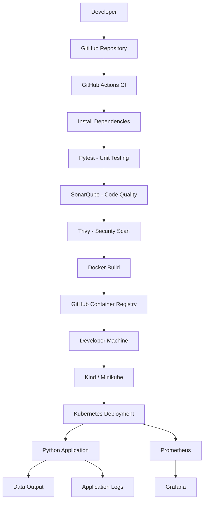

# Architecture Design

## 1. Architecture Overview

This project follows a DevSecOps architecture designed to automate the software delivery lifecycle of a Python-based data extraction application.

The architecture integrates source code management, continuous integration, code quality analysis, security scanning, containerization, container image management, Kubernetes deployment, and monitoring.

The initial implementation will use free and locally accessible infrastructure to avoid AWS and EKS costs.

## 2. High-Level Architecture

The proposed workflow consists of the following stages:

1. Developer pushes application code to GitHub.
2. GitHub Actions automatically triggers the CI workflow.
3. Dependencies are installed and automated tests are executed.
4. SonarQube performs static code quality analysis.
5. Trivy scans dependencies and container images for vulnerabilities.
6. Docker builds the application image.
7. The image is published to GitHub Container Registry (GHCR).
8. The image is pulled into the local Kubernetes environment.
9. Kubernetes deploys and runs the application.
10. Prometheus collects metrics and Grafana visualizes monitoring data.

## 3. Architecture Components

| Component | Responsibility |
|---|---|
| GitHub | Source code management |
| GitHub Actions | CI/CD workflow automation |
| Python | Application development |
| Pytest | Automated application testing |
| SonarQube | Static code quality analysis |
| Trivy | Security and vulnerability scanning |
| Docker | Application containerization |
| GHCR | Container image registry |
| Kind / Minikube | Local Kubernetes environment |
| Kubernetes | Container orchestration |
| Prometheus | Metrics collection |
| Grafana | Monitoring dashboards |

## 4. Continuous Integration (CI) Workflow

The CI workflow begins when a developer pushes code or creates a pull request.

The pipeline performs:

- Source code checkout.
- Python dependency installation.
- Code linting and validation.
- Automated unit testing using Pytest.
- Static code analysis using SonarQube.
- Security and dependency scanning using Trivy.
- Docker image build.
- Container image vulnerability scanning.

The workflow should prevent unsafe or invalid builds from progressing through configured quality and security gates.

## 5. Continuous Delivery (CD) Workflow

After successful CI validation:

- A Docker image is built and tagged.
- The image is published to GitHub Container Registry.
- The image is pulled into the local Kubernetes environment.
- Kubernetes deployment manifests are applied.
- Application health and deployment status are verified.

Initially, deployment to local Kubernetes will be performed from the developer's machine. Automated deployment through a self-hosted GitHub Actions runner will be explored as an advanced enhancement.

## 6. Security Integration

Security will be integrated at different stages of the pipeline.

| Security Layer | Implementation |
|---|---|
| Source Code | SonarQube analysis |
| Dependencies | Trivy filesystem scanning |
| Container Image | Trivy image scanning |
| Repository Secrets | GitHub Actions Secrets |
| Container Access | GHCR permissions |
| Kubernetes | Resource security configurations |

No passwords, access tokens, or credentials will be committed to the public repository.

## 7. Monitoring and Observability

The local Kubernetes environment will integrate:

- Prometheus for metrics collection.
- Grafana for dashboard visualization.
- Kubernetes health checks for application availability.
- Container logs for troubleshooting.

## 8. Infrastructure Design Decisions

The initial environment is designed around free learning resources.

- GitHub-hosted runners will execute CI workflows.
- GHCR will be used for container image storage.
- Docker will provide a consistent application runtime.
- Kind or Minikube will provide local Kubernetes capabilities.
- No paid AWS infrastructure is required.

AWS ECR, EKS, IAM OIDC, S3, and CloudWatch will be discussed as cloud implementation alternatives and future enhancements.

## 9. Expected Architecture Outcome

The expected outcome is a documented, repeatable DevSecOps workflow demonstrating how application code moves from a GitHub repository through automated quality and security validation to containerized execution in Kubernetes.

The project will also demonstrate monitoring, troubleshooting, and continuous improvement practices.

## 10. Implementation Status

Architecture design: Documented.

Actual implementation: Pending.

All architecture components will be marked as implemented only after successful practical validation.
